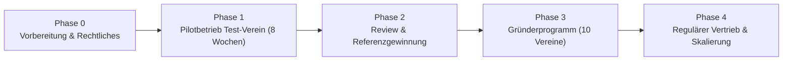

# Produkt-Einführungsplan & Kooperationsleitfaden für den Test-Verein

Dieses Dokument definiert die strategische und operative Roadmap zur Einführung der Schachvereins-Software im Markt sowie das konkrete Konzept für die Pilot-Zusammenarbeit mit einem ersten Referenz- und Test-Verein.

---

## 1. Executive Summary & Ausgangslage

Die Software ist technisch als eigenständige, hochgradig spezialisierte Lösung für Schachvereine konzipiert ([docs/prd.md](file:///C:/Users/xyxyx/Desktop/development/docs/prd.md)). Mit automatisierten Beitragsläufen, Schweizer Turniersystem, Liga-Aufstellungen, Kassenbuch, PWA-Fähigkeit und strengster DSGVO-Konformität (keine externen CDNs/Tracker, verschlüsselte IBANs) bietet sie signifikante Mehrwerte gegenüber generischer Vereinssoftware.

* **Liefer- und Betriebsmodell:** Managed-Abo (pro Verein eine eigene Instanz mit PostgreSQL, gehostet in der Europäischen Union (z. B. Scalingo oder Hetzner), [ADR-009](file:///C:/Users/xyxyx/Desktop/development/docs/decisions/ADR-009-betrieb-caddy-restic-uptime-kuma.md), [ADR-014](file:///C:/Users/xyxyx/Desktop/development/docs/decisions/ADR-014-preisgestaltung.md), [ADR-025](file:///C:/Users/xyxyx/Desktop/development/docs/decisions/ADR-025-hosting-eu-ebene-scalingo.md)).
* **Preisstruktur (Endpreise gem. § 19 UStG):** Start (19 €/Monat, bis 60 Mitglieder), Verein (35 €/Monat, bis 150 Mitglieder), Verband (69 €/Monat).
* **Ziel der Pilotphase:** Nachweis der Praxistauglichkeit im echten Vereinsalltag, Bereinigung von Usability-Hürden, Validierung der wirtschaftlichen Betreuungsannahme (≤ 0,2 h Support pro Verein/Monat) und Gewinnung eines belastbaren Referenzkunden (Case Study / Zitat für die Landingpage `/produkt/`).



---

## 2. Gesamtplan zur Produkteinführung (Roadmap)

### Phase 0: Rechtliche, technische & vertriebliche Grundlagen (Woche 1–2)
Bevor echte Vereinsdaten verarbeitet oder Angebote unterbreitet werden, müssen die formalen Leitplanken stehen:

1. **Rechtliche Dokumente erstellen & prüfen:**
   * **Auftragsverarbeitungsvertrag (AVV gem. Art. 28 DSGVO):** Standardvorlage für Kundenvereine (Muster für Hosting in der EU bei Scalingo/Hetzner, Datenkategorien, technisch-organisatorische Maßnahmen / TOMs; siehe [docs/avv_muster.md](file:///C:/Users/xyxyx/Desktop/development/docs/avv_muster.md)).
   * **AGB & Vertragsunterlagen:** Festlegung der 12-monatigen Mindestlaufzeit, Kündigungsfrist (1 Monat zum Laufzeitende), Klausel zur Kleinunternehmerregelung gem. § 19 UStG sowie Preisanpassungsklausel bei späterem Wechsel zur Regelbesteuerung ([ADR-014](file:///C:/Users/xyxyx/Desktop/development/docs/decisions/ADR-014-preisgestaltung.md)).
   * **Rechtstexte der Website:** Platzhalter in `/impressum/` und `/datenschutz/` durch finale Pflichtangaben ersetzen.
2. **Technisches Deployment-Template finalisieren:**
   * Vorbereitung eines standardisierten Docker-Compose-Stacks für neue Vereinsinstanzen (`kunde1.schachverwaltung.de`).
   * Testen der Backup- und Restore-Routinen ([tools/backup.sh](file:///C:/Users/xyxyx/Desktop/development/tools/backup.sh), [docs/deployment.md](file:///C:/Users/xyxyx/Desktop/development/docs/deployment.md)) und Monitoring via Uptime Kuma ([tasks/plan.md](file:///C:/Users/xyxyx/Desktop/development/tasks/plan.md) Task T24b).
   * Einrichtung der E-Mail-Infrastruktur (SMTP-Zustellbarkeit mit SPF/DKIM zur Vermeidung von Spam-Einstufungen bei Rundbriefen).
3. **Vertriebsmaterialien & Onboarding-Paket:**
   * PDF-Leistungsübersicht basierend auf [docs/funktionen.md](file:///C:/Users/xyxyx/Desktop/development/docs/funktionen.md).
   * Muster-Vorlage (Excel/CSV) für den Datenimport aus Altsystemen.

---

### Phase 1: Pilotbetrieb mit dem Test-Verein (Woche 3–10 / ca. 8 Wochen)
* Detaillierte Durchführung des Pilotprojekts (siehe Kapitel 3 und 4).
* Begleiteter Parallelbetrieb mit schrittweiser Übergabe der Kernprozesse.

---

### Phase 2: Review, Feinjustierung & Referenzerstellung (Woche 11–12)
1. **Auswertung des Betreuungsaufwands:**
   * Dokumentation aller Support-Minuten und Rückfragen zur Prüfung der Kalkulationsannahme aus [ADR-014](file:///C:/Users/xyxyx/Desktop/development/docs/decisions/ADR-014-preisgestaltung.md) (Ziel: ≤ 24 Minuten / 0,4 h pro Monat im Normalbetrieb).
2. **Beseitigung von Usability-Schwachstellen:**
   * Optimierung von Klickwegen oder Formularbeschriftungen, die während der Tests Irritationen hervorgerufen haben.
3. **Erstellung der Fallstudie / Testimonial:**
   * Interview mit dem Kassenwart und 1. Vorsitzenden des Test-Vereins.
   * Zitat und Vereinslogo für die Produkt-Landingpage (`/produkt/`).
   * Aussagekräftige Zahlen aufbereiten (z. B. *„Beitragslauf von 4 Stunden auf 3 Klicks verkürzt“*).

---

### Phase 3: Gründerprogramm – Die ersten 10 Vereine (Monat 4–6)
* **Angebot:** Gründerpreis von **29 € / Monat** (Tarif „Verein“, fest für 24 Monate) für die ersten 10 Vereine gegen Zusage einer Referenznennung und eines quartalsweisen Feedbackgesprächs ([ADR-014](file:///C:/Users/xyxyx/Desktop/development/docs/decisions/ADR-014-preisgestaltung.md) §3).
* **Akquise-Kanal:**
  * Regionale Schachbezirke und Vereine im Umkreis von 50–100 km (persönlicher Bezug).
  * Direkte Ansprache von Vorständen bei Bezirksversammlungen oder Ligaspieltagen (Musteranschreiben siehe [docs/anschreiben_testverein.md](file:///C:/Users/xyxyx/Desktop/development/docs/anschreiben_testverein.md)).
  * Gezielte Postings in Schachforen (z. B. Schachfeld.de, DSB-Vereinsforen).
* **Onboarding:** Jeder der 10 Vereine erhält eine persönliche 60-minütige Video-Einweisung und kostenlose Datenübernahme durch die Entwickler.

---

### Phase 4: Regulärer Vertrieb & Skalierung (ab Monat 7)
* Reguläre Preise: 19 € (Start), 35 € (Verein), 69 € (Verband).
* **Multiplikatoren ansprechen:** Schachlandesverbände und Bezirksspielleiter kontaktieren; Paketangebote für Bezirke (ab 3 Instanzen 10 %, ab 5 Instanzen 15 % Rabatt).
* **Virale Effekte nutzen:** Externe Gäste bei Turnieranmeldungen und Kapitäne gegnerischer Mannschaften sehen das moderne Design und die schnelle Ergebniseingabe (dezenter Link in der Fußzeile: *„Betrieben mit [Produktname]“*).

---

## 3. Die Zusammenarbeit mit dem Test-Verein (Pilot-Kooperation)

### 3.1 Das Profil des idealen Test-Vereins
Der Erfolg der Pilotphase steht und fällt mit der Wahl des Partners. Nicht jeder Verein eignet sich als Tester:

| Kriterium | Idealanforderung | Warum wichtig? |
|---|---|---|
| **Mitgliederzahl** | 35 bis 80 Mitglieder | Repräsentiert den deutschen Durchschnitt (~39 Mitglieder). Groß genug für Beitragsdifferenzierung, klein genug für überschaubaren Test. |
| **Spielbetrieb** | 1 bis 3 aktive Mannschaften | Erforderlich für den Test von Mannschaftsaufstellungen, Brettpunkten, Tabellenberechnung und iCal-Feeds. |
| **Turniere** | Regelmäßige Vereinsabende (Blitz, Vereinsmeisterschaft) | Testet die Schweizer Paarung (`tournaments/pairing.py`), Runderfassung und ChessResults-Export. |
| **Vorstandsteam** | Pragmatischer Kassenwart + digitalaffiner Spielleiter/Kapitän | Kassenwart bewertet Beiträge/Finanzen; Spielleiter bewertet den Samstag/Sonntag-Spielbetrieb. |
| **Schmerzpunkt** | Leidet unter Excel-Chaos, Papierlisten oder DSGVO-Unsicherheit | Echte Motivation, eine funktionierende Ablösung zu finden. |

> [!TIP]
> **Vermeiden:** Reine Kartei-Vereine ohne Mannschaftsspielbetrieb oder Vereine mit notorisch zerstrittenem oder überaltertem Vorstand, der jede digitale Neuerung blockiert.

---

### 3.2 Die Win-Win-Anreizstruktur (Das Angebot an den Verein)
Damit der Test-Verein die nötige Zeit investiert, muss das Angebot hochattraktiv sein:

* **Finanzieller Vorteil:**
  * **12 Monate kostenlose Vollnutzung** der Software (Wert: 420 €).
  * **Lebenslange Preisgarantie** auf den günstigsten Gründertarif (z. B. 25 € statt 35 €/Monat ab Jahr 2).
* **Service-Vorteil:**
  * **Komplette Ersteinrichtung und Datenmigration gratis** (Übernahme der Mitgliederdaten aus Excel/Papier, Einpflegen der Beitragsstruktur und Spielpläne).
  * **Persönliche Betreuung:** Direkter VIP-Draht zu den Entwicklern (WhatsApp/Telefon) mit garantierter Reaktionszeit < 4 Stunden bei Ligaspieltagen und Turnieren.
* **Einfluss:**
  * Exklusives Mitgestaltungsrecht bei neuen Funktionen und Priorisierung von Verbesserungen.

---

### 3.3 Rechtliche Vereinbarung (Pilotvereinbarung & AVV)
Vor dem Produktivsetzen muss eine schlanke schriftliche **Pilotvereinbarung** (1–2 Seiten) geschlossen werden (Muster siehe [docs/pilotvereinbarung_muster.md](file:///C:/Users/xyxyx/Desktop/development/docs/pilotvereinbarung_muster.md)).

**Wesentliche Inhalte:**
1. **Gegenstand:** Bereitstellung einer cloudbasierten Vereinsverwaltungs-Instanz zu Testzwecken für einen Zeitraum von 8–12 Wochen.
2. **Datenschutz (AVV):** Abschluss des Standard-Auftragsverarbeitungsvertrags (AVV nach Art. 28 DSGVO, siehe [docs/avv_muster.md](file:///C:/Users/xyxyx/Desktop/development/docs/avv_muster.md)). Bestätigung, dass die Datenhaltung ausschließlich in der Europäischen Union (EU) erfolgt und sensible Daten (IBANs) verschlüsselt gespeichert werden.
3. **Pflichten des Test-Vereins:**
   * Teilnahme an einem wöchentlichen 15-minütigen Feedbackgespräch während der ersten 4 Wochen.
   * Durchführung der definierten Praxistests (1 Spieltag, 1 Vereinsturnier, 1 Beitrags-Simulationslauf).
   * Benennung von 2 festen Ansprechpartnern (Vorstand/Kasse und Spielbetrieb).
4. **Pflichten des Anbieters:**
   * Bereitstellung der Software, Hosting, tägliche Backups ([tools/backup.sh](file:///C:/Users/xyxyx/Desktop/development/tools/backup.sh)).
   * Zeitnahe Behebung von Fehlern.
   * Keine Weitergabe von Vereinsdaten.
5. **Datenhoheit & Exit-Garantie:**
   * Der Verein bleibt jederzeit alleiniger Eigentümer aller Daten.
   * Jederzeitige Möglichkeit des vollständigen Exports als CSV/PDF.
   * Verpflichtung zur rückstandsfreien Löschung bei Nicht-Fortführung.
6. **Referenznutzung:** Recht des Anbieters, den Verein nach erfolgreichem Abschluss mit Logo und einem kurzen Zitat als Referenz zu nennen.

---

## 4. Phasenplan & Ablauf der Pilotphase (8 Wochen)

```mermaid
gantt
    title 8-Wochen-Pilotfahrplan
    dateFormat  WW
    axisFormat  Woche %W
    section Vorbereitung
    Kickoff & Bestandsaufnahme      :w01, 1w
    Datenübernahme & Setup         :w02, 1w
    section Schulung & Rollout
    Vorstandsschulung & 2FA        :w03, 1w
    Spielbetrieb & Ligatest        :w04, 2w
    section Erweiterte Tests
    Vereinsturnier (Schweizer Sys) :w06, 1w
    Beitragslauf-Simulation        :w07, 1w
    section Abschluss
    Evaluation & Go-Live           :w08, 1w
```

### Woche 1: Kickoff & Altdaten-Inventur
* **Termin (45–60 min):** Treffen mit 1. Vorsitzendem, Kassenwart und Spielleiter.
* **Erfassung der Vereinskonfiguration:**
  * Vereinsname, Kürzel, Gründungsjahr, Anschrift des Vereinsheims, Trainingszeiten für Jugend und Erwachsene ([ADR-012](file:///C:/Users/xyxyx/Desktop/development/docs/decisions/ADR-012-vereinsprofil-in-den-settings.md)).
  * Bestehende Beitragskategorien (z. B. Vollzahler, Jugend, Ermäßigt, Familien) und Beitragssätze.
* **Übergabe der Altdaten:** Export der aktuellen Mitgliederdaten aus Excel, Vereinssoftware oder DSB-Meldeliste.

### Woche 2: Technische Bereitstellung & Datenmigration
* **Deployment:** Eigene Instanz unter Subdomain (z. B. `sc-pilot.schachverwaltung.de`) per Docker Compose aufsetzen, SSL-Zertifikat automatisch via Caddy ausstellen.
* **Datenbereinigung & Import:**
  * Entwickler bereinigen Dubletten, fehlerhafte E-Mail-Adressen und formatieren Geburtsdaten.
  * Einspielen der Mitgliederstammdaten, Beitragssätze und bestehenden SEPA-Mandate.
* **Vorab-Prüfung:** Kassenwart gleicht die importierte Liste gegen seinen Altdatenbestand ab.

### Woche 3: Vorstandsschulung & 2FA-Aktivierung
* **Schulung (60 min via Video oder vor Ort):**
  * Rollenmodell erklären: Vorstand (Admin), Mannschaftskapitän, Mitglied ([docs/prd.md](file:///C:/Users/xyxyx/Desktop/development/docs/prd.md) §3.8).
  * Einrichtung der Zwei-Faktor-Authentifizierung (2FA via Authenticator-App) für alle Vorstandsmitglieder ([core/twofa.py](file:///C:/Users/xyxyx/Desktop/development/core/twofa.py)).
  * Erläuterung des Änderungswunsch-Workflows: Mitglieder fordern Änderungen an, Vorstand gibt frei (Vier-Augen-Prinzip).
* **PWA-Check:** Vorstand installiert die App auf dem Smartphone (Homescreen-Icon, Offline-Fähigkeit testen).

### Woche 4–5: Praxiseinsatz Spielbetrieb (Ernstfall 1)
* **Vorbereitung:** Mannschaften (z. B. 1. Mannschaft, 2. Mannschaft) und Spielpläne der laufenden Saison im System anlegen.
* **Ernstfall am Ligaspieltag:**
  * Mannschaftsführer ruft Aufstellungsmaske auf dem Smartphone auf (mobile Ansicht bei 360 px / Tablet).
  * Erfassung der Brettaufstellung und Speicherung vor Ort.
  * Eingabe der Einzelergebnisse (1 / ½ / 0) nach den Partien.
  * Automatische Tabellenberechnung und Prüfung der Buchholz-Rechnung ([teams/services.py](file:///C:/Users/xyxyx/Desktop/development/teams/services.py)).
  * Abonnieren des iCal-Spielplans durch interessierte Spieler auf dem Handy.

### Woche 6: Praxiseinsatz Vereinsturnier (Ernstfall 2)
* Anlegen eines vereinsinternen Turniers (z. B. Monatsblitz oder Vereinsmeisterschaft über 5 Runden Schweizer System).
* **Öffentliche Anmeldung:** Mitglieder (und ggf. Gäste) melden sich online über `/turniere/<id>/` an.
* **Turnierabend:**
  * Auslosung der Runden über die automatische Schweizer Paarung ([tournaments/pairing.py](file:///C:/Users/xyxyx/Desktop/development/tournaments/pairing.py)).
  * Erfassung der Ergebnisse und Prüfung der Rangliste nach Buchholz-Feinwertung.
  * Test des ChessResults-Exports ([tournaments/views.py](file:///C:/Users/xyxyx/Desktop/development/tournaments/views.py)) und der Druckansicht.

### Woche 7: Beitrags- & Kassen-Simulation (Ernstfall 3)
* **Beitragslauf:** Durchführung eines Testlaufs für das aktuelle Kalenderjahr ([dues/services.py](file:///C:/Users/xyxyx/Desktop/development/dues/services.py)).
* **Zahlungserfassung:** Buchen von Eingängen (Überweisung, SEPA, Barzahlung) und Prüfung der automatischen Gegenbuchung im Kassenbuch ([ADR-006](file:///C:/Users/xyxyx/Desktop/development/docs/decisions/ADR-006-storno-per-gegenbuchung.md)).
* **Mahnwesen:** Generierung druckbarer Mahnbriefe für offene Posten ([dues/templates/dues/mahnbrief.html](file:///C:/Users/xyxyx/Desktop/development/dues/templates/dues/mahnbrief.html)).
* **Jahresabschluss:** Export des Kassenbuchs als CSV für den Kassenprüfer/Steuerberater ([cashbook/views.py](file:///C:/Users/xyxyx/Desktop/development/cashbook/views.py)).
* **DSGVO-Auskunftstest:** Test-Auskunft eines Mitglieds als PDF/JSON mit einem Klick erzeugen ([core/dsgvo.py](file:///C:/Users/xyxyx/Desktop/development/core/dsgvo.py)).

### Woche 8: Auswertung, Feedback & Übergabe in den Echtbetrieb
* Abschlussgespräch mit Vorstand und Kassenwart anhand der Abnahme-Kriterien ([docs/abnahme.md](file:///C:/Users/xyxyx/Desktop/development/docs/abnahme.md)).
* Einholen des Testimonials / Referenztextes.
* Unterzeichnung des regulären (kostenfreien) Nutzungsvertrags für die ersten 12 Monate.

---

## 5. Feedback-Management & Incident-Klassifizierung

Während der Pilotphase benötigt der Test-Verein klare Kommunikationswege, um Frustrationen zu vermeiden.

### 5.1 Eskalationsstufen im Pilotbetrieb

| Priorität | Definition | Reaktionszeit | Vorgehen |
|---|---|---|---|
| **P1 - Blocker** | Systemausfall am Spieltag oder Turnier, Login scheitert, Datenverlust droht | < 1 Stunde (telefonisch) | Sofortige Fehleranalyse, ggf. Rückgriff auf Notfall-Backup |
| **P2 - Hürde** | Funktion eingeschränkt, aber Workaround möglich (z. B. Export-Formatierung ungenau, Wording unklar) | < 24 Stunden | Behebung im nächsten Patch |
| **P3 - Verbesserung** | Komfortwunsch, optische Optimierung, Feature-Idee für v1.2 | Im wöchentlichen Review | Aufnahme ins Product Backlog |

### 5.2 Vorlage: Wöchentliches 15-Minuten-Check-in-Protokoll

```text
Datum: ___________  Teilnehmer: _________________________________________

1. Was lief diese Woche besonders gut?
   - ____________________________________________________________________

2. Wo gab es Hürden oder Verwirrung bei Vorständen / Mitgliedern?
   - ____________________________________________________________________

3. Wurden Daten im Altsystem parallel gepflegt? Wenn ja, warum?
   - ____________________________________________________________________

4. Erfasster Betreuungsaufwand der Entwickler diese Woche: ______ Minuten.

5. Nächster Meilenstein für die kommende Woche:
   - ____________________________________________________________________
```

---

## 6. Erfolgskriterien für den Pilotabschluss (Go/No-Go)

Der Pilot gilt als erfolgreich und die Software als marktreif, wenn folgende Kriterien erfüllt sind:

1. **Vollständige Ablösung der Altsysteme:** Der Kassenwart führt für Mitglieder und Finanzen keine separaten Excel-Dateien mehr.
2. **Eigenständige Bedienung:** Der Vorstand kann Beitragsläufe, Rundbriefe und Auskünfte ohne Hilfe der Entwickler ausführen.
3. **Spieltag & Turnier bestanden:** Mindestens ein Punktspiel und ein Klubturnier wurden ohne Datenverlust oder Programmabsturz erfasst.
4. **Support-Zielgröße erreicht:** Der laufende Supportaufwand sinkt nach Woche 4 auf unter 30 Minuten pro Monat.
5. **Positive Referenz:** Der Vorstand stellt ein unterzeichnetes Statement zur Veröffentlichung bereit.

---

## 7. Sofortige nächste Schritte

1. **Rechtliche Vorlagen erstellen:** AVV-Muster ([docs/avv_muster.md](file:///C:/Users/xyxyx/Desktop/development/docs/avv_muster.md)) und 2-seitige Pilotvereinbarung ([docs/pilotvereinbarung_muster.md](file:///C:/Users/xyxyx/Desktop/development/docs/pilotvereinbarung_muster.md)) anfertigen.
2. **Deployment-Skript für Kundeninstanzen:** Erstellung eines Docker-Compose-Templates für Mandanteninstanzen.
3. **Identifikation des Test-Vereins:** Ansprache von 2–3 befreundeten oder regionalen Schachvereinen anhand der Kriterienmatrix aus § 3.1 mit dem Musteranschreiben ([docs/anschreiben_testverein.md](file:///C:/Users/xyxyx/Desktop/development/docs/anschreiben_testverein.md)).
4. **Kickoff terminieren:** Durchführung des 45-minütigen Vorbereitungsgesprächs mit dem ausgewählten Testverein.
