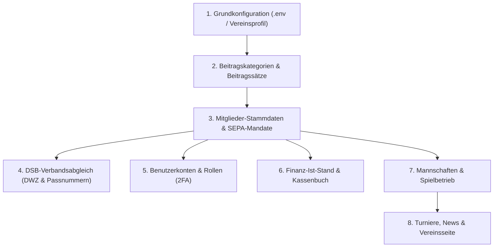

# Ersteinrichtung – Leitfaden für die erstmalige Datenbefüllung

Dieser Leitfaden führt die Vereinsleitung (Vorstand, Kassenwart, Spielleiter) Schritt für Schritt durch die **erstmalige Datenerfassung** nach der technischen Installation.

Aufgrund von Fremdschlüssel-Beziehungen und fachlichen Abhängigkeiten (z. B. benötigt jedes Mitglied eine Beitragskategorie; jede Mannschaftsaufstellung benötigt bestehende Mitglieder) **muss** die folgende Reihenfolge eingehalten werden.

---

## Ablaufübersicht

---

## 1. Grundkonfiguration & Vereinsprofil

Bevor Fachdaten über das Webinterface erfasst werden, müssen die Basisdaten des Vereins in der Server-Konfiguration (`.env.prod`) hinterlegt sein:

1. **Vereinsdaten ([ADR-012](decisions/ADR-012-vereinsprofil-in-den-settings.md)):**
   * `CLUB_NAME` (z. B. `Schachclub Königsspringer Musterstadt e.V.`)
   * `CLUB_FOUNDED` (Gründungsjahr, z. B. `1978`)
   * `CLUB_LOCATION` (Ort, z. B. `Musterstadt`)
   * `CLUB_ROOM` (Spiellokal/Vereinsheim, Anschrift)
   * `CLUB_NIGHT_HOURS` (z. B. `Donnerstags ab 19:00 Uhr`)
   * `CLUB_YOUTH_HOURS` (z. B. `Donnerstags 17:30 – 19:00 Uhr`)
   * `CLUB_DESCRIPTION` (Kurztext für Fußzeile und Meta-Tags)
2. **Verbandskennungen & Finanzen:**
   * `DSB_VKZ` (Vereinskennziffer beim Deutschen Schachbund, z. B. `C0101`, siehe [ADR-016](decisions/ADR-016-dsb-schnittstellen-architektur.md))
   * `SEPA_CREDITOR_ID` (Gläubiger-Identifikationsnummer für Lastschriften, siehe [ADR-017](decisions/ADR-017-sepa-xml-export-pain-008.md))
3. **Erster Vorstandszugang:**
   * Superuser anlegen (`docker compose exec app python manage.py createsuperuser`).
   * Beim ersten Login auf `/anmelden/` die **Zwei-Faktor-Authentifizierung (2FA)** per Authenticator-App verbindlich einrichten ([docs/wartung.md](wartung.md)).

---

## 2. Beitragskategorien & Beitragssätze definieren (`dues`)

> [!IMPORTANT]
> **Warum vor den Mitgliedern?** Jedes Mitglied wird direkt einer Beitragskategorie (`FeeCategory`) zugeordnet. Ohne Kategorien können Mitglieder nicht vollständig gespeichert werden.

* **Pfad:** `/beitraege/kategorien/` bzw. Django-Admin `/admin/dues/feecategory/`
* **Vorgehen:**
  1. Alle im Verein geltenden Beitragskategorien anlegen (z. B. *Erwachsene*, *Jugendliche*, *Ermäßigt*, *Familienbeitrag*, *Passive / Fördermitglieder*).
  2. Für jede Kategorie den Jahresbeitrag (`FeeAmount`) für das aktuelle Beitragsjahr hinterlegen ([ADR-004](decisions/ADR-004-beitragssaetze-kategorie-und-betrag-getrennt.md)).

---

## 3. Mitglieder-Stammdaten & SEPA-Mandate erfassen (`members`)

* **Pfad:** Menü **Mitglieder** &rarr; **Mitglied aufnehmen** (`/mitglieder/neu/`)
* **Vorgehen:**
  1. **Stammdaten:** Vor- und Nachname, Geburtsdatum, Eintrittsdatum, Status (`aktiv` oder `passiv`), Wohnanschrift und E-Mail-Adresse.
  2. **Beitragskategorie:** Die in Schritt 2 angelegte passende Kategorie auswählen.
  3. **E-Mail-Opt-In:** Haken setzen, wenn das Mitglied Vereinsrundschreiben empfangen möchte (DSGVO-konformes Opt-in, PRD M5.2).
  4. **SEPA-Mandat (bei Lastschrift):** In der Detailansicht des Mitglieds das SEPA-Mandat mit IBAN, Mandatsreferenz und Unterschriftsdatum hinterlegen.
     * *Datenschutz:* Die IBAN wird in der Datenbank automatisch mit AES-256 verschlüsselt gespeichert ([ADR-010](decisions/ADR-010-iban-verschluesselt-in-der-datenbank.md)) und in Masken nur gekürzt dargestellt (`DE89 •••• 1234`).

> [!TIP]
> **Massen-Import aus Altsystemen (Web & Admin):** Bei größeren Beständen können Mitgliederdaten direkt über die Web-Oberfläche importiert werden:
> 1. **Geführter Setup-Assistent:** Unter `/admin/setup/` bzw. `/verein/setup/` (Onboarding-Wizard, [ADR-020](decisions/ADR-020-vereinsstammdaten-in-der-datenbank.md)) mit Schritt-für-Schritt-Validierung und optionaler automatischer SEPA-Mandatsanlage.
> 2. **Django Admin Import/Export:** Unter `/admin/members/member/import/` ([ADR-021](decisions/ADR-021-django-import-export-im-admin.md)) mit Dateigrößen-Schutz (max. 2 MB, T31b), Dry-Run-Vorschau und Formatunterstützung für CSV/XLSX.

---

## 4. DSB-Verbandsabgleich (DWZ & Passnummern)

* **Pfad:** Menü **Mitglieder** &rarr; **DSB-Abgleich** (`/mitglieder/dsb-sync/`)
* **Vorgehen:**
  1. Über den Button **„Verbandsdaten aktualisieren“** die offizielle Vereinsliste vom DSB-Portal abrufen ([ADR-016](decisions/ADR-016-dsb-schnittstellen-architektur.md)).
  2. Die Diskrepanzerkennung (*Drift Detection*) zeigt alle Mitglieder mit abweichenden oder fehlenden Wertungszahlen.
  3. Per **„Alle synchronisieren“** werden ZPS-Passnummern, DWZ-Zahlen, DWZ-Indizes und FIDE-IDs automatisch in die Mitgliederdaten übernommen. Manuelles Abtippen entfällt.

---

## 5. Benutzerkonten & Rollen verteilen (`core`)

* **Pfad:** `/admin/auth/user/`
* **Vorgehen:**
  1. Benutzerkonten für die Vereinsfunktionäre anlegen und mit dem jeweiligen `Member`-Datensatz verknüpfen.
  2. Gruppen gemäß Berechtigungsmatrix ([docs/prd.md](prd.md) §3.8) zuweisen:
     * **`admin`** (Vorstand, Kassenwart): Voller Systemzugriff, 2FA-Pflicht.
     * **`kapitaen`** (Mannschaftsführer): Zugriff auf Aufstellungen und Ergebniseingabe.
     * **`mitglied`** (Optionale Zugänge für Spieler): Einsicht ins eigene Profil (`/profil/`), Spieltags-Zu-/Absagen und Adressänderungsanträge.

---

## 6. Finanz-Ist-Stand & Kassenbuch synchronisieren (`cashbook`, `dues`)

1. **Kassenbuch-Eröffnungsbestand:**
   * Unter **Kassenbuch** (`/kasse/neu/`) eine Eröffnungsbuchung mit dem aktuellen Saldo des Girokontos bzw. der Barkasse erfassen.
2. **Beitragslauf des laufenden Jahres:**
   * Unter **Beiträge** (`/beitraege/lauf/`) den Beitragslauf für das aktuelle Kalenderjahr ausführen.
   * Bereits vor Softwareeinführung gezahlte Beiträge für die Mitglieder über **„Zahlung erfassen“** buchen, damit die offenen Posten und das Mahnwesen dem realen Kassenstand entsprechen ([ADR-005](decisions/ADR-005-beitragsposten-idempotenz-und-momentaufnahme.md)).

---

## 7. Mannschaften & Spielbetrieb aufsetzen (`teams`)

> [!IMPORTANT]
> **Warum nach den Mitgliedern?** Mannschaften referenzieren Mitglieder als Kapitäne und Brettspieler in der Rangliste.

* **Pfad:** Menü **Spielbetrieb** &rarr; **Mannschaften** (`/mannschaften/`)
* **Vorgehen:**
  1. **Saison & Mannschaften anlegen:** Im Admin unter *Teams &rarr; Saisons* die aktive Hauptsaison (z. B. 2026/2027, [ADR-027](decisions/ADR-027-saisonverwaltung-fuer-den-vorstand.md)) festlegen. Anschließend Mannschaften (z. B. *1. Mannschaft*, *2. Mannschaft*) der Saison zuordnen und Mannschaftsführer benennen.
  2. **Rangliste / Stammaufstellung:** Spieler der Reihenfolge nach den Brettern zuordnen.
  3. **Spielplan anlegen:** Begegnungen der Saison mit Datum, Uhrzeit, Heim-/Auswärtsspiel und gegnerischem Verein eintragen.
  4. Die iCal-Kalenderfeeds für Spieler und die Verfügbarkeits-Abfrage (1-Klick-Rückmeldung) sind damit sofort einsatzbereit.

---

## 8. Vereinsleben, Turniere & Öffentliche Website (`comms`, `tournaments`)

1. **Aktuelles / News (`/aktuelles/`):**
   * Erste Begrüßungsnachricht oder Ankündigung zur neuen Saison verfassen und veröffentlichen.
2. **Vereinsturniere (`/turniere/`):**
   * Das nächste anstehende Turnier (z. B. Vereinsmeisterschaft, Monatsblitz) anlegen, damit die öffentliche Anmeldung freigeschaltet ist.
3. **Abschlussprüfung Website:**
   * Öffentliche Seiten (`/`, `/verein/`, `/aktuelles/`, `/turniere/`) auf dem Smartphone (360 px) und Desktop gegenprüfen.

---

## Checkliste vor dem Go-Live

- [ ] Alle Beitragskategorien haben einen Jahresbeitrag für das laufende Jahr.
- [ ] Alle aktiven Mitglieder sind erfasst und einer Beitragskategorie zugewiesen.
- [ ] DSB-Sync erfolgreich ausgeführt (DWZ-Werte aktuell).
- [ ] Vorstandsmitglieder haben 2FA erfolgreich eingerichtet.
- [ ] Anfangsbestand im Kassenbuch stimmt mit dem Kontoauszug überein.
- [ ] Mannschaften und Spielplan der laufenden Saison sind vollständig.
- [ ] Tägliches automatisches Backup läuft fehlerfrei (`docs/deployment.md`).
