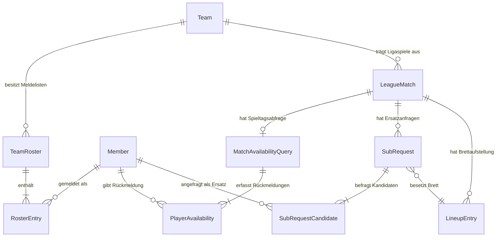
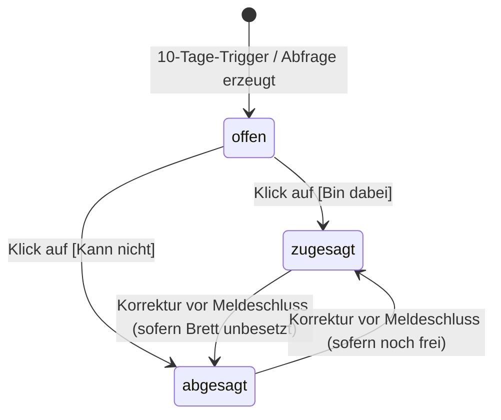
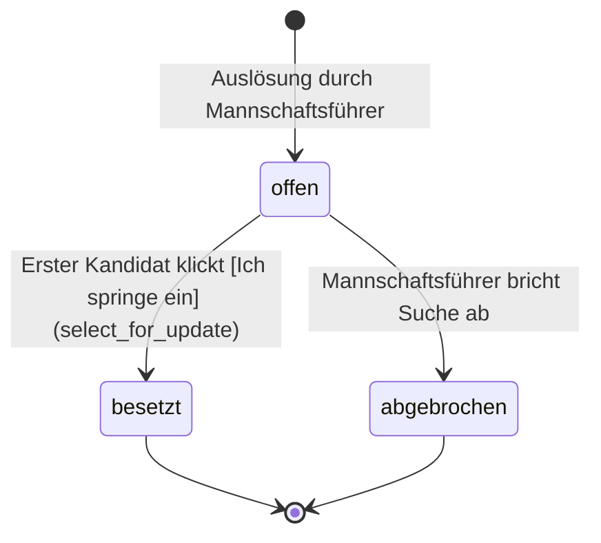

# Data Model: Mannschaftskampf-Autopilot

**Feature**: `001-mannschaftskampf-autopilot` | **Date**: 2026-10-17 | **Spec**: [spec.md](spec.md)

---

## Entitätsübersicht & Relationen

---

## 1. Modellerweiterung: `Team` (`teams/models.py`)

Bestehendes Modell wird um Festspielkonfiguration erweitert:

| Feld | Typ | Nullable | Default | Beschreibung |
|---|---|---|---|---|
| `festspiel_schwelle` | `PositiveSmallIntegerField` | Nein | `2` | Erlaubte freie Einsätze in höheren Mannschaften vor Festspielen (DSB: 2, 3. Einsatz fest) |
| `stammspieler_abfrage_tage` | `PositiveSmallIntegerField` | Nein | `10` | Vorlaufzeit für den automatischen Abfragestart in Tagen |

---

## 2. Neues Modell: `TeamRoster` (`teams/models.py`)

Repräsentiert die offizielle Saisonmeldung einer Mannschaft (FR-001).

| Feld | Typ | Nullable | Default | Beschreibung |
|---|---|---|---|---|
| `id` | `BigAutoField` | Nein | Auto | Primärschlüssel |
| `team` | `ForeignKey(Team)` | Nein | CASCADE | Zugeordnete Mannschaft |
| `saison` | `CharField(20)` | Nein | `"2026/2027"` | Spielzeit / Saisonbezeichnung |
| `gueltig_ab` | `DateField` | Nein | - | Gültigkeitsbeginn der Meldung |
| `ist_aktiv` | `BooleanField` | Nein | `True` | Ob diese Meldung die aktuell gültige ist |
| `bemerkung` | `CharField(250)` | Ja (blank) | `""` | Optionale Notiz des Spielleiters |
| `erstellt_am` | `DateTimeField` | Nein | auto_now_add | Audit-Zeitstempel |

**Constraints & Indizes**:
- `UniqueConstraint(fields=["team", "saison"], name="unique_team_saison_roster")`
- `ordering = ["team", "-saison"]`

---

## 3. Neues Modell: `RosterEntry` (`teams/models.py`)

Einzelner Spieler auf der Meldeliste mit Rang- und Stammbrettzuordnung.

| Feld | Typ | Nullable | Default | Beschreibung |
|---|---|---|---|---|
| `id` | `BigAutoField` | Nein | Auto | Primärschlüssel |
| `roster` | `ForeignKey(TeamRoster)` | Nein | CASCADE | Zugehörige Mannschaftsmeldung |
| `member` | `ForeignKey(Member)` | Nein | CASCADE | Vereinsmitglied |
| `rangnummer` | `PositiveSmallIntegerField` | Nein | - | Offizielle Rangnummer (1, 2, 3...) |
| `stammbrett` | `PositiveSmallIntegerField` | Ja (blank) | `None` | Stammbrett (1 bis 8); `NULL` für Ersatzspieler |
| `ist_stammspieler` | `BooleanField` | Nein | `False` | `True`, wenn Stammspieler der Mannschaft |

**Validierung & Constraints**:
- `UniqueConstraint(fields=["roster", "rangnummer"], name="unique_roster_rangnummer")`
- `UniqueConstraint(fields=["roster", "stammbrett"], condition=Q(stammbrett__isnull=False), name="unique_roster_stammbrett")`
- `ordering = ["roster", "rangnummer"]`

---

## 4. Neues Modell: `MatchAvailabilityQuery` (`teams/models.py`)

Lebenszyklus der automatischen 10-Tage-Verfügbarkeitsabfrage eines Ligaspiels (FR-002).

| Feld | Typ | Nullable | Default | Beschreibung |
|---|---|---|---|---|
| `id` | `BigAutoField` | Nein | Auto | Primärschlüssel |
| `match` | `OneToOneField(LeagueMatch)` | Nein | CASCADE | Ligaspiel |
| `status` | `CharField(20)` | Nein | `"laeuft"` | `laeuft`, `abgeschlossen` |
| `gestartet_am` | `DateTimeField` | Nein | auto_now_add | Auslösezeitpunkt |
| `letzte_erinnerung_am` | `DateTimeField` | Ja (blank) | `None` | Zeitstempel letzter Erinnerungslauf |

---

## 5. Neues Modell: `PlayerAvailability` (`teams/models.py`)

Rückmeldung eines Spielers samt Magic-Link-Token und Fahrgemeinschaftsstatus (FR-003, FR-009, FR-011).

| Feld | Typ | Nullable | Default | Beschreibung |
|---|---|---|---|---|
| `id` | `BigAutoField` | Nein | Auto | Primärschlüssel |
| `query` | `ForeignKey(MatchAvailabilityQuery)` | Nein | CASCADE | Übergeordnete Abfrage |
| `member` | `ForeignKey(Member)` | Nein | CASCADE | Spieler |
| `stammbrett` | `PositiveSmallIntegerField` | Ja | `None` | Stammbrett des Spielers |
| `status` | `CharField(20)` | Nein | `"offen"` | Status: `offen`, `zugesagt`, `abgesagt` |
| `fahr_status` | `CharField(25)` | Nein | `"keine_angabe"` | `keine_angabe`, `brauche_mitfahrt`, `biete_mitfahrt`, `selbst_anreise` |
| `freie_plaetze` | `PositiveSmallIntegerField` | Nein | `0` | Angebotene Plätze (falls `biete_mitfahrt`) |
| `treffpunkt_notiz` | `CharField(150)` | Ja (blank) | `""` | Notiz zu Anreise/Treffpunkt |
| `token_hash` | `CharField(64)` | Nein | - | SHA-256-Hash des Magic Tokens (gehasht) |
| `token_gueltig_bis` | `DateTimeField` | Nein | - | Gültigkeitsende (Spielbeginn) |
| `rueckmeldung_am` | `DateTimeField` | Ja | `None` | Zeitstempel der letzten Rückmeldung |

**Indizes & Constraints**:
- `UniqueConstraint(fields=["query", "member"], name="unique_player_availability_per_match")`
- `Index(fields=["token_hash"], name="idx_availability_token_hash")`

---

## 6. Neues Modell: `SubRequest` (`teams/models.py`)

Ersatzspieler-Gesuch für ein unbesetztes Brett nach einer Absage (FR-005, FR-007, FR-008).

| Feld | Typ | Nullable | Default | Beschreibung |
|---|---|---|---|---|
| `id` | `BigAutoField` | Nein | Auto | Primärschlüssel |
| `match` | `ForeignKey(LeagueMatch)` | Nein | CASCADE | Ligaspiel |
| `brett` | `PositiveSmallIntegerField` | Nein | - | Betroffenes Brett (1..8) |
| `ausfall_member` | `ForeignKey(Member)` | Ja | SET_NULL | Ursprünglicher Stammspieler |
| `status` | `CharField(20)` | Nein | `"offen"` | Status: `offen`, `besetzt`, `abgebrochen` |
| `erstellt_von` | `ForeignKey(Member)` | Ja | SET_NULL | Mannschaftsführer / Auslöser |
| `erstellt_am` | `DateTimeField` | Nein | auto_now_add | Zeitstempel |
| `akzeptiert_von` | `ForeignKey(Member)` | Ja | SET_NULL | Erfolgreicher Ersatzspieler (FCFS) |
| `akzeptiert_am` | `DateTimeField` | Ja | `None` | Zeitstempel der Zusage |

---

## 7. Neues Modell: `SubRequestCandidate` (`teams/models.py`)

Einzelner angefragter Kandidat einer Ersatzanfrage.

| Feld | Typ | Nullable | Default | Beschreibung |
|---|---|---|---|---|
| `id` | `BigAutoField` | Nein | Auto | Primärschlüssel |
| `sub_request` | `ForeignKey(SubRequest)` | Nein | CASCADE | Übergeordnetes Gesuch |
| `member` | `ForeignKey(Member)` | Nein | CASCADE | Ersatzkandidat |
| `mannschaft_ursprung` | `ForeignKey(Team)` | Nein | CASCADE | Heimatmannschaft des Spielers |
| `rangnummer` | `PositiveSmallIntegerField` | Nein | - | Rangnummer in der Meldeliste |
| `bisherige_einsaetze` | `PositiveSmallIntegerField` | Nein | `0` | Einsätze in höheren Mannschaften der Saison |
| `festspiel_status` | `CharField(20)` | Nein | `"gruen"` | `gruen`, `warnung_letzter`, `festgespielt` |
| `status` | `CharField(20)` | Nein | `"angefragt"` | `angefragt`, `zugesagt`, `zu_spaet`, `abgelehnt` |
| `token_hash` | `CharField(64)` | Nein | - | SHA-256-Hash des Magic Tokens |
| `token_gueltig_bis` | `DateTimeField` | Nein | - | Gültigkeitsende |
| `benachrichtigt_per_mail` | `BooleanField` | Nein | `False` | E-Mail erfolgreich versendet |
| `geantwortet_am` | `DateTimeField` | Ja | `None` | Zeitstempel des Klicks |

**Constraints**:
- `UniqueConstraint(fields=["sub_request", "member"], name="unique_candidate_per_sub_request")`
- `Index(fields=["token_hash"], name="idx_sub_candidate_token_hash")`

---

## Zustandstransitionen (State Machines)

### PlayerAvailability

### SubRequest (First-Come-First-Serve)

