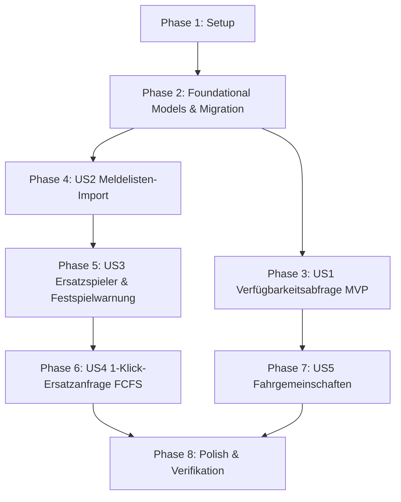

# Implementation Tasks: Mannschaftskampf-Autopilot

**Feature**: `001-mannschaftskampf-autopilot` | **Date**: 2026-10-17 | **Spec**: [spec.md](spec.md) | **Plan**: [plan.md](plan.md)

---

## Phase 1: Setup (Shared Infrastructure)

**Purpose**: Modellerweiterung, Token-Sicherheit und Routing-Grundlagen für den Autopilot.

- [ ] T001 Modellerweiterung in `teams/models.py`: `Team` um `festspiel_schwelle` (PositiveSmallIntegerField, default=2, help_text="Erlaubte freie Einsätze in höheren Mannschaften") und `stammspieler_abfrage_tage` (PositiveSmallIntegerField, default=10) erweitern.
- [ ] T002 [P] Kryptografische Token- und Hashing-Hilfsfunktionen (`generate_magic_token`, `hash_magic_token`) in `teams/services.py` implementieren (`secrets.token_urlsafe(32)` und `hashlib.sha256`).
- [ ] T003 [P] URL-Routen für den Autopilot in `teams/urls.py` definieren (`/spielbetrieb/meldeliste/import/`, `/spielbetrieb/rueckmeldung/<token>/`, `/spielbetrieb/ersatz/<token>/`, `/spielbetrieb/spiele/<pk>/ersatz/<brett>/`).

---

## Phase 2: Foundational (Blocking Prerequisites)

**Purpose**: Datenmodelle für Roster, Verfügbarkeiten und Ersatzanfragen sowie Datenbank-Migrationen.

- [ ] T004 Datenmodelle `TeamRoster` (`team` FK CASCADE, `saison` CharField(20) default="2026/2027", `gueltig_ab` DateField, `ist_aktiv` BooleanField default=True, UniqueConstraint `team`+`saison`) und `RosterEntry` (`roster` FK CASCADE, `member` FK CASCADE, `rangnummer` PositiveSmallIntegerField, `stammbrett` PositiveSmallIntegerField nullable, `ist_stammspieler` BooleanField default=False, Unique `roster`+`rangnummer`, Unique `roster`+`stammbrett` condition stammbrett not null) in `teams/models.py` definieren.
- [ ] T005 Datenmodelle `MatchAvailabilityQuery` (`match` OneToOne CASCADE, `status` CharField in ["laeuft", "abgeschlossen"], `gestartet_am` DateTimeField auto_now_add) und `PlayerAvailability` (`query` FK CASCADE, `member` FK CASCADE, `stammbrett` PositiveSmallIntegerField nullable, `status` in ["offen", "zugesagt", "abgesagt"], `fahr_status` in ["keine_angabe", "brauche_mitfahrt", "biete_mitfahrt", "selbst_anreise"], `freie_plaetze` PositiveSmallIntegerField default=0, `token_hash` CharField(64) indexed, `token_gueltig_bis` DateTimeField, `rueckmeldung_am` DateTimeField nullable, UniqueConstraint `query`+`member`) in `teams/models.py` definieren.
- [ ] T006 Datenmodelle `SubRequest` (`match` FK CASCADE, `brett` PositiveSmallIntegerField, `ausfall_member` FK SET_NULL nullable, `status` in ["offen", "besetzt", "abgebrochen"], `akzeptiert_von` FK SET_NULL nullable, `akzeptiert_am` DateTimeField nullable) und `SubRequestCandidate` (`sub_request` FK CASCADE, `member` FK CASCADE, `mannschaft_ursprung` FK CASCADE, `rangnummer` PositiveSmallIntegerField, `bisherige_einsaetze` PositiveSmallIntegerField default=0, `festspiel_status` in ["gruen", "warnung_letzter", "festgespielt"], `status` in ["angefragt", "zugesagt", "zu_spaet", "abgelehnt"], `token_hash` CharField(64) indexed, `token_gueltig_bis` DateTimeField, UniqueConstraint `sub_request`+`member`) in `teams/models.py` definieren.
- [ ] T007 Django-Migration für alle neuen Tabellen und Relationen erstellen und via `docker compose exec app python manage.py migrate` verifizieren (`teams/migrations/`).
- [ ] T008 [P] Django-Admin-Klassen für `TeamRoster`, `RosterEntry`, `MatchAvailabilityQuery` und `SubRequest` mit schreibgeschützten Audit- und Token-Hash-Feldern in `teams/admin.py` registrieren.

---

## Phase 3: User Story 1 - Automatische Verfügbarkeitsabfrage vor dem Spieltag (Priority: P1) 🎯 MVP

**Goal**: Zehn Tage vor dem Spieltag erhalten Stammspieler passwortfreie Magic-Links per E-Mail zur sofortigen Zu- oder Absage ([Bin dabei] / [Kann nicht] / [Fahrbedarf]).

**Independent Test**: Management-Command erzeugt für ein Spiel in 10 Tagen Abfragen mit eindeutigen Tokens; Aufruf des Magic-Links speichert Status; Negativtest: abgelaufenes/ungültiges Token liefert 404; AuditLog wird geschrieben.

### Tests für User Story 1 🧪
- [ ] T009 [P] [US1] Unit- und Integrationstests für Verfügbarkeitsabfrage und Magic-Link in `teams/tests/test_autopilot.py` schreiben (Negativtests: 404 bei gefälschtem/abgelaufenem Token, Idempotenz des 10-Tage-Laufs, Reversibilität der Rückmeldung vor Fristende).

### Implementation für User Story 1
- [ ] T010 [US1] Service-Funktion `create_match_availability_query(match)` und E-Mail-Generierung mit Magic-Link in `teams/services.py` implementieren.
- [ ] T011 [US1] Django Management-Command `process_match_queries` in `teams/management/commands/process_match_queries.py` implementieren (ermittelt Spiele mit `datum - localdate() == 10 Tage` und führt Abfrageerstellung aus).
- [ ] T012 [P] [US1] Mobile Magic-Link-View `availability_magic_view` (GET/POST) in `teams/views.py` implementieren.
- [ ] T013 [P] [US1] Mobile-First Templates `teams/templates/teams/autopilot/availability_form.html` und `availability_thanks.html` erstellen (responsive ab 360 px, semantische Buttons `[Bin dabei]` / `[Kann nicht]`, DSGVO-konform ohne Fremd-Assets).
- [ ] T014 [US1] Rückmeldestatus-Übersicht für Mannschaftsführer in `teams/templates/teams/match_detail.html` und View `match_detail` integrieren.

---

## Phase 4: User Story 2 - Import der offiziellen Mannschaftsmeldelisten (Priority: P2)

**Goal**: Einmaliger Upload von Saison-Meldelisten (CSV/Excel) mit Validierung, Dry-Run-Vorschau und Zuordnung zu Mitgliedern.

**Independent Test**: Upload einer Test-CSV zeigt im Dry-Run erkannte Mannschaften und Zuordnungen; verbindlicher Import speichert `TeamRoster` und `RosterEntry`; Negativtest: 403 für unberechtigte Rollen, Ablehnung doppelter Rangziffern.

### Tests für User Story 2 🧪
- [ ] T015 [P] [US2] Tests für Meldelisten-Import in `teams/tests/test_roster_import.py` schreiben (Negativtests: 403 für Rolle `mitglied`, Ablehnung doppelter Rangnummern, Dry-Run verhindert Schreibzugriffe, Audit-Dokumentation).

### Implementation für User Story 2
- [ ] T016 [US2] Formular `RosterImportForm` in `teams/forms.py` erstellen (Datei-Upload, Saisonwahl, Checkbox `dry_run`).
- [ ] T017 [US2] Service-Funktion `import_team_roster(file_obj, saison, dry_run=True, actor=None)` in `teams/services.py` implementieren (CSV/Excel-Parsing, Namens-/Nummern-Matching gegen `Member`, Validierung doppelter Ränge/Bretter).
- [ ] T018 [US2] View `team_roster_import` mit Rollenschutz `@role_required(ADMIN_GROUP, KAPITAEN_GROUP)` in `teams/views.py` implementieren.
- [ ] T019 [P] [US2] Template `teams/templates/teams/roster_import.html` für Upload und Dry-Run-Vorschau mit Fehlertabelle erstellen.

---

## Phase 5: User Story 3 - Regelkonforme Ersatzspieler-Ermittlung & Festspiel-Warnung (Priority: P1)

**Goal**: Automatische Ermittlung berechtigter Ersatzspieler aus unteren Mannschaften anhand der Rangliste mit Festspielprüfung (DSB-Schwelle) und Terminkollisionsprüfung.

**Independent Test**: Spieler mit 2 Einsätzen in höheren Teams wird mit gelber/roter Festspielwarnung markiert; Spieler mit eigenem Ligaspiel am selben Tag wird mit Terminkollision markiert; reine Funktion erfüllt `assertNumQueries`.

### Tests für User Story 3 🧪
- [ ] T020 [P] [US3] Tests für Ersatzspieler-Ermittlung in `teams/tests/test_substitution_finder.py` schreiben (Reine Service-Tests mit `assertNumQueries`: DSB-Festspielgrenze bei 2 vs. 3 Einsätzen, Terminkollision, Sortierung nach Rangordnung).

### Implementation für User Story 3
- [ ] T021 [US3] Reine Service-Funktion `get_eligible_substitutes(match, board_number)` in `teams/services.py` implementieren (Hierarchie unterer Teams, Roster-Rangreihenfolge, Terminkollisionen, Zählung von `LineupEntry`-Einsätzen in höheren Teams der Saison, Status `gruen`/`warnung_letzter`/`festgespielt`).
- [ ] T022 [US3] View `match_sub_finder` (GET) in `teams/views.py` implementieren (Zugriff für Mannschaftsführer und Admin).
- [ ] T023 [P] [US3] Modal/Template `teams/templates/teams/autopilot/sub_finder_modal.html` erstellen (Ampel-Badges, hervorgehobene Festspiel-Warnboxen, Kontrollkästchen zur Vorauswahl aller berechtigten Kandidaten).

---

## Phase 6: User Story 4 - 1-Klick-Ersatzanfrage (First-Come-First-Serve) (Priority: P2)

**Goal**: 1-Klick-Sammelanfrage an vorausgewählte Kandidaten per E-Mail und WhatsApp Click-to-Chat (`wa.me`); transaktionsgesicherte Zusage (FCFS).

**Independent Test**: Anfrage an 2 Kandidaten; Kandidat 1 klickt zuerst und sichert sich Brett 4; Kandidat 2 klickt danach und erhält freundliche Ablehnungsseite; Transaktionssicherheit bei zeitgleichem Klick.

### Tests für User Story 4 🧪
- [ ] T024 [P] [US4] Tests für First-Come-First-Serve und Ersatzanfragen in `teams/tests/test_sub_request_fcfs.py` schreiben (Transaktionstest mit `select_for_update`, Ablehnung nach Besetzung, WhatsApp Click-to-Chat-Link-Formatierung).

### Implementation für User Story 4
- [ ] T025 [US4] Service-Funktionen `create_sub_request(match, board_number, candidate_member_ids, actor)` und `claim_sub_seat(candidate_token)` mit `transaction.atomic()` und `select_for_update()` in `teams/services.py` implementieren.
- [ ] T026 [US4] View `match_sub_request_dispatch` (POST) in `teams/views.py` implementieren (erzeugt `SubRequest`, versendet E-Mails, generiert `wa.me`-Vorlagen und schreibt AuditLog).
- [ ] T027 [P] [US4] Mobile Ersatzspieler-Views `sub_claim_magic_view` (GET/POST) in `teams/views.py` implementieren.
- [ ] T028 [P] [US4] Mobile-First Templates `teams/templates/teams/autopilot/sub_claim_form.html` und `sub_already_taken.html` erstellen.

---

## Phase 7: User Story 5 - Koordination von Fahrgemeinschaften (Priority: P3)

**Goal**: Erfassung von Fahrstatus und freien Plätzen bei Auswärtsspielen; aggregierte Ampel- und Platzanzeige im Spieltags-Cockpit.

**Independent Test**: Zusagen mit „Biete 3 Plätze“ und „Brauche Mitfahrt“ ergeben korrekten Saldo (+2 Plätze, Status grün); Negativtest: Heimspiel zeigt kein Fahrgemeinschafts-Widget.

### Tests für User Story 5 🧪
- [ ] T029 [P] [US5] Tests für Fahrgemeinschaften-Aggregation in `teams/tests/test_carpool.py` schreiben (Aggregation freier Plätze vs. Gesuche, Ampel-Status, Nicht-Anzeige bei Heimspielen).

### Implementation für User Story 5
- [ ] T030 [US5] Reine Service-Funktion `get_carpool_summary(match)` in `teams/services.py` implementieren.
- [ ] T031 [P] [US5] Template-Snippet `teams/templates/teams/includes/carpool_widget.html` erstellen und in `teams/templates/teams/match_detail.html` einbinden.

---

## Phase 8: Polish & Cross-Cutting Concerns

**Purpose**: Audit-Spur, Barrierefreiheit, mobile Responsivität und Gesamtverifikation.

- [ ] T032 [P] AuditLog-Integration für alle Autopilot-Aktionen (Roster-Upload, Aufstellungsumbesetzungen, Ersatzanfragen) in `teams/services.py` und `core/signals.py` vervollständigen.
- [ ] T033 [P] Mobile Responsivitäts- und Accessibility-Check (WCAG 2.1 AA) bei 360 px und 1280 px ohne horizontalen Scrollbalken für alle neuen Autopilot-Templates durchführen.
- [ ] T034 Alle 5 Validierungsszenarien aus `specs/001-mannschaftskampf-autopilot/quickstart.md` durchführen und dokumentieren.
- [ ] T035 Gesamte Testsuite ausführen (`docker compose exec app pytest teams/`) und Query-Budgets (`assertNumQueries`) verifizieren.

---

## Dependencies & Execution Order

### Phase Dependencies

- **Setup (Phase 1)**: Keine Abhängigkeiten – kann sofort beginnen.
- **Foundational (Phase 2)**: Hängt von Setup (Phase 1) ab – **BLOCKIERT alle User Stories**.
- **User Story 1 (Phase 3) [MVP]**: Hängt von Phase 2 ab.
- **User Story 2 (Phase 4)**: Hängt von Phase 2 ab.
- **User Story 3 (Phase 5)**: Hängt von Phase 2 und Phase 4 (Meldelisten-Daten) ab.
- **User Story 4 (Phase 6)**: Hängt von Phase 5 (Ersatzkandidaten-Ermittlung) ab.
- **User Story 5 (Phase 7)**: Hängt von Phase 3 (Rückmeldungen) ab.
- **Polish (Phase 8)**: Hängt vom Abschluss aller gewünschten User Stories ab.

---

## Parallel Execution Opportunities

- **In Phase 1**: T002 (Token-Crypto) und T003 (URLs) können parallel entwickelt werden.
- **In Phase 2**: T008 (Admin-Klassen) kann parallel zu Modellerweiterungen laufen.
- **In Phase 3 (US1)**: Test T009 und Template T013 können parallel zur Service-Logik T010/T011 erstellt werden.
- **In Phase 4 (US2)**: Test T015 und Template T019 können parallel zum Service T017 entwickelt werden.
- **In Phase 5 (US3)**: Test T020 und Modal T023 können parallel zum Service T021 implementiert werden.
- **In Phase 6 (US4)**: Test T024 und Templates T028 können parallel zu T025/T026 implementiert werden.
- **In Phase 7 (US5)**: Test T029 und Widget T031 können parallel zum Service T030 entwickelt werden.

---

## Implementation Strategy

### MVP First (User Story 1)
1. Phase 1 (Setup) & Phase 2 (Foundational) abschließen.
2. Phase 3 (User Story 1) umsetzen und testen.
3. **Validierung**: 10-Tage-Trigger und Magic-Link mobil testen → MVP einsatzfähig!

### Inkrementeller Ausbau
1. Phase 4 (Meldelisten-Import) hinzufügen → offizielle Saisonmeldungen digital hinterlegt.
2. Phase 5 (Ersatzspieler & Festspielprüfung) hinzufügen → automatische Regelkonformität.
3. Phase 6 (1-Klick-Ersatzanfrage First-Come-First-Serve) hinzufügen → Last-Minute-Krisen gelöst.
4. Phase 7 (Fahrgemeinschaften) hinzufügen → Logistik-Erleichterung bei Auswärtsspielen.
5. Phase 8 (Polish) abschließen → vollständige Revisionssicherheit und Freigabe.
