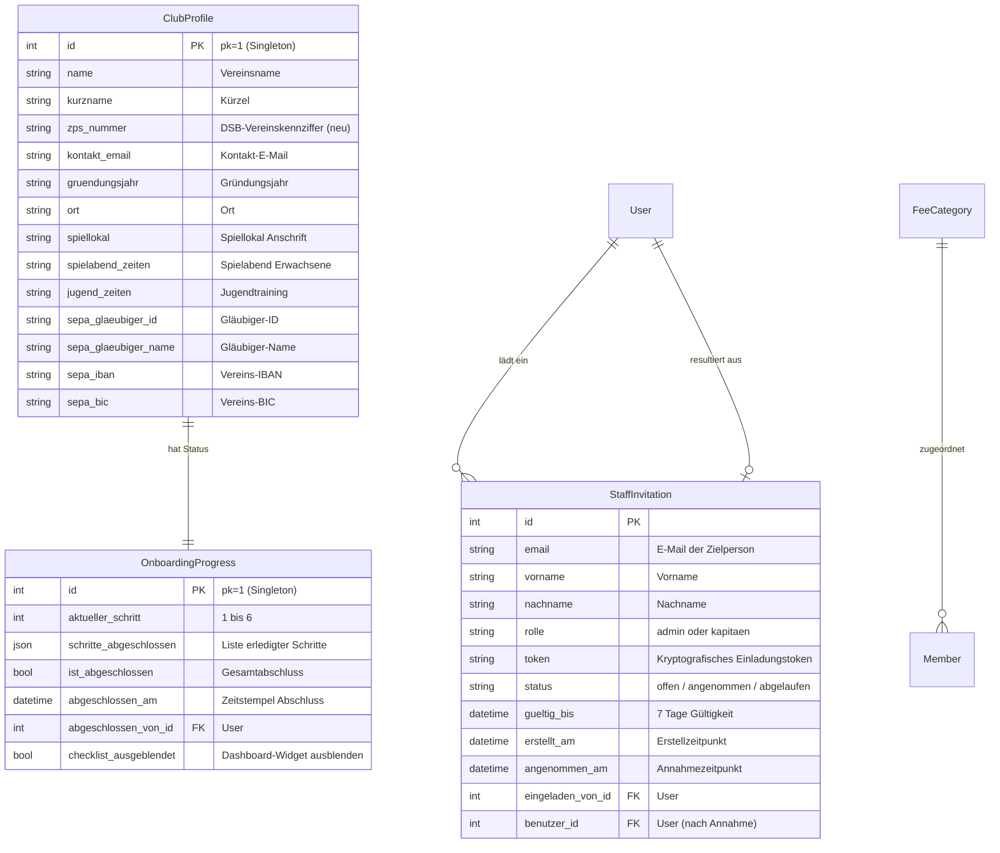

# Phase 1: Data Model: Vereins-Onboarding

**Feature**: Onboarding für einen neuen Schachverein (`002-vereins-onboarding`)  
**Datum**: 2026-10-16  
**Status**: Completed  

---

## 1. Modell-Übersicht & Beziehungen



---

## 2. Detaillierte Modellbeschreibungen

### 2.1 Erweiterung: `ClubProfile` (`core/models.py`)

Das bestehende Singleton-Modell `ClubProfile` (ADR-020) wird um das Feld für den Verbandsschlüssel erweitert:

| Feldname | Typ | Attribute | Fachliche Bedeutung & Validierung |
|---|---|---|---|
| `zps_nummer` | `CharField` | `max_length=10, blank=True` | Offizielle 5-stellige DSB-Vereinskennziffer (z. B. `C0101` oder `10101`), genutzt für DSB-Wertungsportal-Abgleiche und ZPS-Schnellimport. |

*Alle übrigen Felder (`name`, `kurzname`, `kontakt_email`, `gruendungsjahr`, `ort`, `spiellokal`, `spielabend_zeiten`, `jugend_zeiten`, `sepa_*`) bleiben unverändert.*

---

### 2.2 Neues Modell: `OnboardingProgress` (`core/models.py`)

Singleton-Modell zur Nachhaltung des Onboarding-Zustands.

| Feldname | Typ | Attribute | Validierungsregeln |
|---|---|---|---|
| `id` | `AutoField` | `primary_key=True` | Immer `pk=1` (Singleton). `save()` erzwingt `pk=1`, `delete()` ist unterbunden. |
| `aktueller_schritt` | `PositiveSmallIntegerField` | `default=1` | Wertebereich 1 bis 6: <br>1: Profil & Stammdaten<br>2: Modulauswahl<br>3: Beitragsstruktur<br>4: Mitglieder-Datenübernahme<br>5: Funktionäre einladen<br>6: Abschluss & Produktivstart |
| `schritte_abgeschlossen` | `JSONField` | `default=list` | Liste der Strings der erfolgreich validierten Schritte, z. B. `["profil", "module", "beitraege"]`. |
| `ist_abgeschlossen` | `BooleanField` | `default=False` | `True`, sobald der Assistent im Schritt 6 final abgeschlossen wurde. |
| `abgeschlossen_am` | `DateTimeField` | `null=True, blank=True` | Zeitstempel des Abschlusses. |
| `abgeschlossen_von` | `ForeignKey(User)` | `null=True, blank=True, on_delete=SET_NULL` | Verweis auf den Administrator, der das Onboarding finalisiert hat. |
| `checklist_ausgeblendet` | `BooleanField` | `default=False` | Steuert die Sichtbarkeit des „Erste Schritte“-Widgets auf dem Vorstandsdashboard. |

#### Methoden
- `get_solo()`: Klassenmethode, liefert die Singleton-Instanz (erzeugt sie bei Bedarf).
- `mark_step_completed(step_name: str)`: Fügt den Schritt atomar zur Liste hinzu und persistiert.
- `can_access_step(step_nr: int) -> bool`: Prüft, ob vorherige Pflichtschritte erfüllt sind.
- `is_onboarding_needed() -> bool`: Liefert `True`, wenn `not ist_abgeschlossen and ClubProfile.get_solo().name == ""` (für den Erst-Redirect).

---

### 2.3 Neues Modell: `StaffInvitation` (`core/models.py`)

Speichert temporäre Einladungs-Tokens für Vorstandsmitglieder und Mannschaftskapitäne.

| Feldname | Typ | Attribute | Validierungsregeln |
|---|---|---|---|
| `id` | `BigAutoField` | `primary_key=True` | Fortlaufender Primärschlüssel. |
| `email` | `EmailField` | `db_index=True` | E-Mail-Adresse der eingeladenen Person (Pflicht). |
| `vorname` | `CharField` | `max_length=50` | Vorname für Personalisierung und automatische Benutzeranlage. |
| `nachname` | `CharField` | `max_length=50` | Nachname. |
| `rolle` | `CharField` | `max_length=20` | Auswahl: `admin` (Vorstand) oder `kapitaen` (Mannschaftsführer). |
| `token` | `CharField` | `max_length=64, unique=True, db_index=True` | URL-sicheres Zufallstoken (`secrets.token_urlsafe(32)`). |
| `status` | `CharField` | `max_length=20, default="offen"` | Auswahl: `offen`, `angenommen`, `abgelaufen`, `widerrufen`. |
| `gueltig_bis` | `DateTimeField` | `db_index=True` | Gültigkeitsdauer (Standard: Erstellzeitpunkt + 7 Tage). |
| `erstellt_am` | `DateTimeField` | `auto_now_add=True` | Erstellungszeitpunkt. |
| `angenommen_am` | `DateTimeField` | `null=True, blank=True` | Zeitpunkt der Passwortvergabe und Kontoaktivierung. |
| `eingeladen_von` | `ForeignKey(User)` | `on_delete=CASCADE, related_name="ausgesprochene_einladungen"` | Ausführender Administrator. |
| `benutzer` | `OneToOneField(User)` | `null=True, blank=True, on_delete=SET_NULL, related_name="staff_invitation"` | Nach Annahme verknüpftes Django-Benutzerkonto. |

#### Zustandsübergänge (State Machine)
```text
           [ Einladung erstellen ]
                      │
                      ▼
                  ┌───────┐
                  │ offen │
                  └───┬───┘
         ┌────────────┼────────────┐
         │            │            │
         ▼            ▼            ▼
   [ Token        [ Frist       [ Durch Admin
   eingelöst ]   abgelaufen ]    widerrufen ]
         │            │            │
         ▼            ▼            ▼
   ┌───────────┐ ┌──────────┐ ┌────────────┐
   │angenommen │ │abgelaufen│ │ widerrufen │
   └───────────┘ └──────────┘ └────────────┘
```

#### Validierungsregeln
- `is_valid()`: Liefert `True`, wenn `status == "offen"` und `timezone.now() <= gueltig_bis`.
- Mehrfache offene Einladungen an dieselbe E-Mail-Adresse für dieselbe Rolle werden entwertet (neues Token löst altes ab).

---

## 3. Best-Practice-Vorlagen für Beitragskategorien (`core/constants.py`)

Für Schritt 3 (Beitragsstruktur) werden schachspezifische Standardvorlagen definiert, die der Administrator per Klick übernehmen und anpassen kann:

```python
DEFAULT_FEE_CATEGORIES = [
    {
        "name": "Erwachsene (Vollzahler)",
        "beschreibung": "Regulärer Jahresbeitrag für aktive erwachsene Mitglieder",
        "betrag": 72.00,
    },
    {
        "name": "Jugendliche / Schüler / Studenten",
        "beschreibung": "Ermäßigter Beitrag für Kinder, Jugendliche unter 18 Jahren und Auszubildende",
        "betrag": 36.00,
    },
    {
        "name": "Senioren (ab 65 Jahre)",
        "beschreibung": "Ermäßigter Beitrag für Seniorinnen und Senioren",
        "betrag": 50.00,
    },
    {
        "name": "Passive Mitglieder / Förderer",
        "beschreibung": "Unterstützende Mitgliedschaft ohne aktive Spielberechtigung",
        "betrag": 30.00,
    },
]
```

---

## 4. Revisionssicherheit & Datenschutz (AuditLog)

Jede Aktion im Onboarding erzeugt unveränderliche Einträge im `AuditLog`:
- `Vereinsprofil im Onboarding aktualisiert` (Wer, Wann, geänderte Stammdaten)
- `Satellitenmodule im Onboarding konfiguriert` (Aktive Module)
- `Standard-Beitragskategorien übernommen` (Angelegte Beitragssätze)
- `Mitglieder-ZPS-Direktimport durchgeführt` (ZPS-Kennung, Anzahl importierter Spieler)
- `Mitglieder-CSV-Import im Onboarding durchgeführt` (Dateiname, Anzahl Mitglieder, Anzahl Mandate)
- `Funktionärseinladung erstellt` (E-Mail, Rolle, Gültigkeitsfrist)
- `Funktionärseinladung angenommen` (Neuer Benutzername, Rolle)
- `Onboarding final abgeschlossen` (Abschließender Admin, Zeitstempel)
