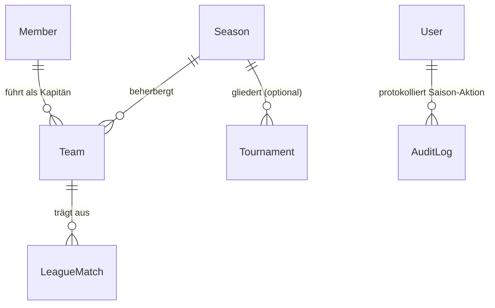
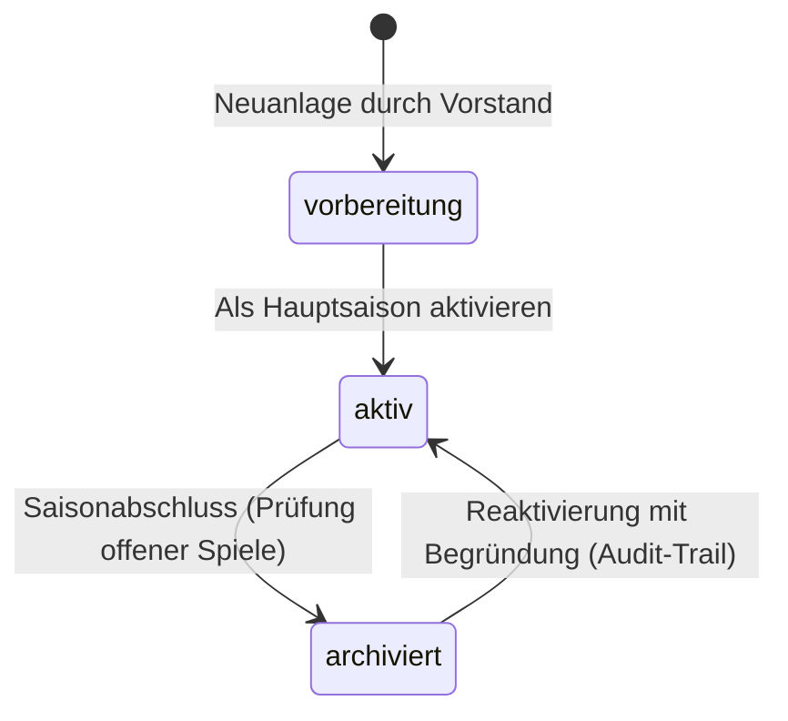

# Data Model: Saisonverwaltung für den Vereinsvorstand

**Feature**: `004-saison-verwaltung` | **Date**: 2026-10-17 | **Spec**: [spec.md](spec.md)

---

## Entitätsübersicht & Relationen

---

## 1. Neues Modell: `Season` (`teams/models.py`)

Repräsentiert ein sportliches Spieljahr des Schachvereins (z. B. `2026/2027`).

| Feld | Typ | Nullable | Default | Beschreibung |
|---|---|---|---|---|
| `id` | `BigAutoField` | Nein | Auto | Primärschlüssel |
| `name` | `CharField(50)` | Nein | - | Eindeutiger Name (z. B. „2026/2027“, „2025/2026“) |
| `slug` | `SlugField(60)` | Nein | Auto | URL-sicherer Bezeichner (z. B. `2026-2027`) |
| `startdatum` | `DateField` | Nein | - | Beginn des Spieljahres (typisch: 01.08. oder 01.07.) |
| `enddatum` | `DateField` | Nein | - | Ende des Spieljahres (typisch: 31.07. oder 30.06.) |
| `status` | `CharField(20)` | Nein | `"vorbereitung"` | Choices: `vorbereitung`, `aktiv`, `archiviert` |
| `ist_aktiv` | `BooleanField` | Nein | `False` | Genau eine Saison ist das aktuelle Hauptspieljahr |
| `notizen` | `TextField` | Ja (blank) | `""` | Interne Notizen des Vorstands / Spielleiters |
| `erstellt_am` | `DateTimeField` | Nein | auto_now_add | Erstellungszeitpunkt |
| `aktualisiert_am` | `DateTimeField` | Nein | auto_now | Letzte Änderung |

### Status-Zustandsübergänge (State Machine)

### Constraints & Validierung
- **Name-Eindeutigkeit**: `unique=True` auf `name` und `slug`.
- **Zeitraumprüfung**: `clean()` stellt sicher, dass `startdatum < enddatum` gilt.
- **Aktive Saison**: Nur Saisons im Status `vorbereitung` oder `aktiv` können als `ist_aktiv=True` gesetzt werden. Das Setzen auf aktiv setzt alle anderen Datensätze atomar auf `ist_aktiv=False`.
- **Löschsperre**: `delete()` wirft `ValidationError` / `ProtectedError`, wenn `self.teams.exists()` oder `self.turniere.exists()`.

### Model-Methoden & Properties
- `get_aktive_saison()`: Liefert die aktuelle Hauptsaison (`ist_aktiv=True`), Fallback auf chronologisch jüngste.
- `ist_archiviert`: Gibt `True` zurück, wenn `status == Season.Status.ARCHIVIERT`.
- `anzahl_teams`: Berechnete Anzahl zugeordneter Mannschaften.
- `anzahl_spiele`: Berechnete Anzahl ausgetragener Ligaspiele.

---

## 2. Modellerweiterung: `Team` (`teams/models.py`)

Das bestehende Mannschaftsmodell wird fest an die Saison gekoppelt:

| Feld | Typ | Nullable | Default | Beschreibung |
|---|---|---|---|---|
| `saison` | `ForeignKey(Season)` | Nein | - | Zugeordnete Saison (`on_delete=models.PROTECT`, `related_name="teams"`) |
| `name` | `CharField(100)` | Nein | - | Mannschaftsname (z. B. „1. Mannschaft“) |
| `liga` | `CharField(120)` | Ja (blank) | `""` | Liga / Staffel in dieser Spielzeit |
| `altersklasse` | `CharField(20)` | Nein | `ERWACHSENE` | Altersklasse (Erwachsene, Jugend, Senioren) |
| `brettanzahl` | `PositiveSmallIntegerField` | Nein | `8` | Bretter je Wettkampf |
| `kapitaen` | `ForeignKey(Member)` | Ja (blank) | `None` | Mannschaftsführer:in |
| `aktiv` | `BooleanField` | Nein | `True` | Ob das Team am Spielbetrieb teilnimmt |
| `ical_token` | `CharField(64)` | Nein | Auto | Eindeutiges Token für den Kalenderfeed |

### Constraints & Indizes
- **Vorher**: `unique=True` auf `name`.
- **Neu**: `UniqueConstraint(fields=["name", "saison"], name="unique_team_per_saison")`.
- `ordering = ["saison__startdatum", "name"]`.

---

## 3. Beziehung zu `LeagueMatch` (`teams/models.py`)

`LeagueMatch` referenziert unverändert `team = ForeignKey(Team, on_delete=models.CASCADE, related_name="matches")`.
- Die Saisonzugehörigkeit eines Ligaspiels ist transitiv über `match.team.saison` gegeben.
- **Validierungsregel**: Das Spieldatum `datum` muss innerhalb des Saisonfensters liegen (`team.saison.startdatum <= match.datum <= team.saison.enddatum`).
- **Schreibschutz**: Wenn `team.saison.ist_archiviert` wahr ist, sind Aufstellungsmeldung, Ergebniserfassung und Terminänderungen blockiert.

---

## 4. Modellerweiterung: `Tournament` (`tournaments/models.py`)

| Feld | Typ | Nullable | Default | Beschreibung |
|---|---|---|---|---|
| `saison` | `ForeignKey("teams.Season")` | Ja (blank) | `None` | Optionale Zuordnung zur Saison (`on_delete=models.SET_NULL`, `related_name="turniere"`) |

- Erlaubt das Filtern von Vereinsturnieren (Vereinsmeisterschaft, Pokal) nach Saison.
- Bleibt optional, um saisonunabhängige Sommer- oder Jubiläumsturniere zu unterstützen.
